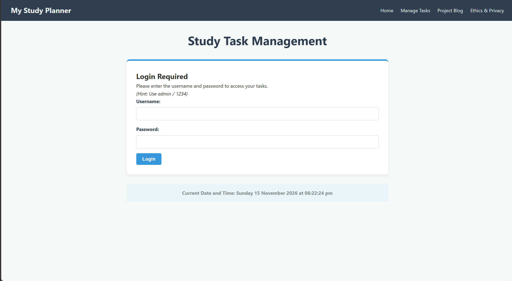

# My Study Planner - Study Task Management Application

## Project Description
My Study Planner is a comprehensive web-based application designed to help students effectively organize and manage their academic responsibilities. It provides a central, user-friendly interface to track assignments, quizzes, and project deadlines in one location, reducing stress and improving productivity. The application is built using HTML5 for structure, CSS3 for styling, and vanilla JavaScript for interactivity.

**GitHub Repository URL:** https://github.com/HanJiazhuo-web/11.15

## Key Features
- **Home Page:** App overview, personal introduction, and a dynamic JavaScript image carousel.
- **Task Management (Core):** Secure login system (Username: admin, Password: 1234) to restrict access.
- **CRUD Operations:** Users can Create, View, Update (Edit), and Delete study tasks.
- **Data Validation:** Prevents empty required fields and rejects due dates in the past.
- **Live Date & Time:** Displays the current date and time dynamically at the bottom of the task page.
- **Project Blog:** Documents the Agile development process, a 3-week sprint plan, and a troubleshooting log.
- **Ethics & Privacy:** A reflection on ethical data use and privacy-conscious design.

## How to Install and Run the Project
1. Clone this repository to your local machine:
   git clone https://github.com/HanJiazhuo-web/11.15
2. Open the project folder in Visual Studio Code.
3. Run the project by opening index.html in any modern web browser (Chrome, Edge, Firefox, etc.). Alternatively, you can use the Live Server extension in VS Code for real-time updates.

## Comprehensive Usage Instructions
1. **Navigation:** Use the top navigation bar to switch between the Home, Manage Tasks, Project Blog, and Ethics & Privacy pages.
2. **Home Page:** Click the blue "Change Image" button to cycle through the study images.
3. **Manage Tasks (Core Functionality):**
   - Navigate to the "Manage Tasks" page.
   - Log in using the credentials: admin / 1234.
   - Fill out the form to add a new task (ensure the date is today or in the future). Click "Add Task".
   - To modify a task, click the yellow "Edit" button next to it, update the details, and click "Update Task".
   - To remove a task, click the red "Delete" button. A system confirmation dialog will appear to prevent accidental deletion.
4. **Logout:** Click the red "Logout" button to secure the task page again.

## Application Screenshot
Below is a screenshot of the main home page and its features:

## Credits and References
- CSS Flexbox and layout guidance from W3Schools (https://www.w3schools.com/).
- JavaScript Date formatting reference from MDN Web Docs (https://developer.mozilla.org/).
- Academic concepts (Agile, Ethics) referenced from INFO7012 course materials.

## License
This project is licensed under the MIT License.